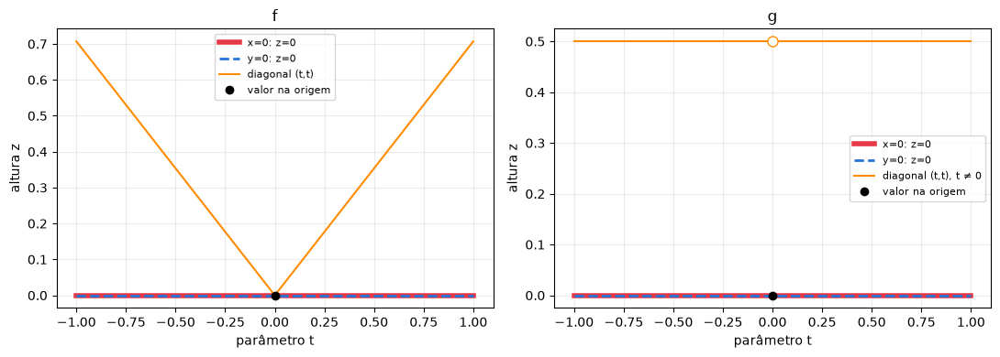
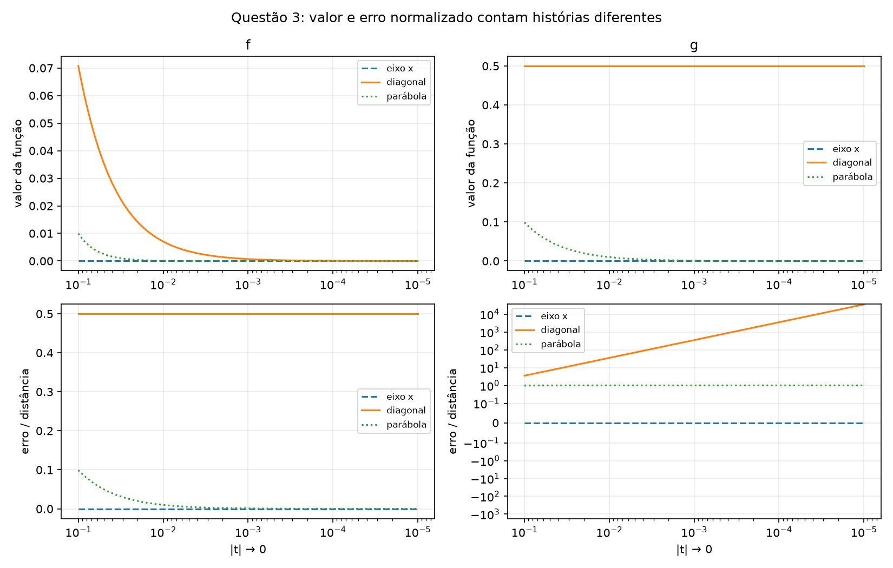
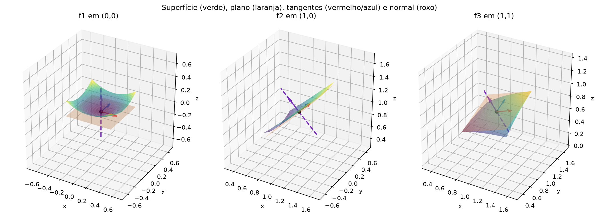
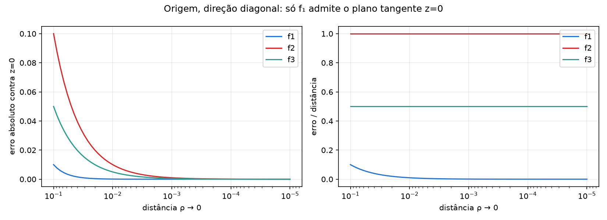

# Apoio ao relatório — questões 3 e 4

Este material reúne resultados verificados, justificativas e imagens para o integrante responsável pelo relatório. Os notebooks continuam separados: `questao3.ipynb` e `questao4.ipynb`, na raiz do projeto. Este arquivo não é o relatório final da equipe.

Fonte do enunciado: `Trabalho_Calculo_II_Modelagem_Computacional_Engenharia_Software.pdf`, páginas 2 e 3. As imagens são geradas a partir dos mesmos modelos matemáticos dos notebooks. Experimentos e gráficos ilustram; as demonstrações justificam as conclusões.

## Questão 3 — resultados e justificativas

Considere f(x,y)=xy/√(x²+y²) e g(x,y)=xy/(x²+y²), ambas com valor zero na origem.

| Propriedade na origem | f | g |
|---|---|---|
| Derivadas parciais | f_x=f_y=0 | g_x=g_y=0 |
| Continuidade | Sim | Não |
| Diferenciabilidade | Não | Não |
| Aplicação linear candidata | L(h,k)=0 | L(h,k)=0 |

1. **Parciais pela definição:** nos eixos, os valores das funções são zero. Portanto, para qualquer incremento não nulo, os quocientes incrementais são zero, inclusive para incrementos negativos. Todas as parciais na origem são zero.
2. **Cortes:** as interseções com x=0 e y=0 são retas horizontais, com inclinações zero. A diagonal revela comportamentos que os eixos escondem: f(t,t)=|t|/√2 e g(t,t)=1/2 para t≠0, enquanto g(0,0)=0.
3. **Candidata linear:** as parciais determinam L=0. Isso ainda não comprova diferenciabilidade.
4. **Definição de diferenciabilidade:** o erro dividido pela distância é Q_f=hk/(h²+k²) e Q_g=hk/(h²+k²)^(3/2). Em (t,t), Q_f=1/2 e Q_g=1/(2√2|t|). Nenhum tende a zero; as duas funções não são diferenciáveis na origem.
5. **Continuidade:** como 2|xy|≤x²+y², temos |f(x,y)|≤√(x²+y²)/2→0=f(0,0). Para g, o eixo dá limite zero e a diagonal dá 1/2; o limite na origem não existe.

Na parábola (t,t²), Q_f=t/(1+t²)→0. Já Q_g=sgn(t)/(1+t²)^(3/2), com limites laterais 1 e −1. Esse exemplo mostra por que investigar somente um lado do parâmetro pode esconder diferenças.

**Relações lógicas:** diferenciabilidade implica continuidade e existência das parciais. A recíproca falha: g mostra que parciais não garantem continuidade; f mostra que continuidade junto com parciais não garante diferenciabilidade. Um único caminho contrário refuta um limite; alguns caminhos favoráveis não o provam.

**Figura 1.** Os eixos têm cortes horizontais nas duas superfícies. Na diagonal, f tem uma ponta e g tem valor 1/2 fora da origem, com o valor zero marcado separadamente na origem. O círculo aberto em g representa o ponto ausente da curva diagonal em altura 1/2.

**Figura 2.** Coluna esquerda: f e seu erro normalizado. Coluna direita: g e seu erro normalizado. A origem é aproximada para a direita; a escala vertical do painel inferior direito é simétrica logarítmica para mostrar tanto o zero quanto o crescimento do quociente. Os parâmetros são t>0. A diagonal já refuta a diferenciabilidade de ambas as funções.

**Observação sobre a visualização 3D do notebook:** em g, uma pequena vizinhança da origem é omitida apenas na malha gráfica para evitar interpolação artificial da descontinuidade. Isso não altera seu domínio, que é todo o plano, nem o valor g(0,0)=0.

## Questão 4 — resultados e justificativas

As funções são f₁=x²+y², f₂=√(x²+y²) e f₃=xy/√(x²+y²), com f₃(0,0)=0.

| Função | Na origem | Fora da origem |
|---|---|---|
| f₁ | Diferenciável; plano z=0 e normal vertical | Diferenciável |
| f₂ | Parciais bilaterais inexistentes; sem diferencial | Diferenciável |
| f₃ | Contínua, parciais zero, mas sem diferencial | Diferenciável |

Para r=√(a²+b²)>0, os gradientes são:

- f₁: (2a,2b), fórmula válida também na origem;
- f₂: (a/r,b/r);
- f₃: (b³/r³,a³/r³).

Nos pontos diferenciáveis, P=(a,b,f(a,b)), T_x=(1,0,f_x), T_y=(0,1,f_y) e N=T_x×T_y=(−f_x,−f_y,1). O plano é z=f(a,b)+f_x(x−a)+f_y(y−b) e a reta normal é P+tN, t real. O produto escalar de N com cada vetor tangente é zero, e P satisfaz a equação do plano.

**Justificativa dos casos regulares:** f₁ é polinomial. Fora da origem, f₂ e f₃ têm parciais contínuas em uma vizinhança que não contém a origem. Assim são diferenciáveis nesses pontos.

**Falhas na origem:** no cone, o quociente incremental |h|/h possui limites laterais diferentes; as parciais bilaterais não existem. Em f₃, as parciais existem e são zero, mas o erro normalizado na diagonal é 1/2. As tangentes dos cortes dos eixos têm produto vetorial vertical, sem que isso valide um plano tangente à superfície via diferencial.

**Aproximação local:** para f₁, em qualquer ponto, o erro contra o plano é exatamente ρ², logo o erro normalizado é ρ→0. Em pontos regulares de f₂ e f₃, o resto de Taylor é O(ρ²) numa vizinhança adequada, logo o erro normalizado tende a zero. Na origem, contra a referência horizontal z=0, f₂ tem erro normalizado 1; f₃ tem 1/2 na diagonal. Em ambos, o erro absoluto pode diminuir sem validar tangência via diferencial.

**Figura 3.** Casos válidos: paraboloide na origem, cone em (1,0) e f₃ em (1,1). Superfície em verde, plano em laranja, ponto em preto, tangentes em vermelho/azul e normal em roxo. As direções das setas são preservadas, com comprimentos ajustados para leitura. A reta normal é mostrada apenas em um trecho finito. As escalas dos três eixos de cada painel são iguais.

**Figura 4.** Aproximação à origem pela diagonal, parametrizada pela distância ρ. Os três erros absolutos diminuem. Apenas o erro normalizado de f₁ tende a zero; os de f₂ e f₃ permanecem em 1 e 1/2, respectivamente. Para f₂ e f₃, z=0 é uma referência diagnóstica; não é anunciado como plano tangente via diferencial.

## Roteiro de demonstração da equipe

1. Questão 3: mostrar as definições das parciais e os cortes horizontais.
2. Selecionar a diagonal e reduzir o parâmetro: Q_f fica em 1/2, Q_g cresce.
3. Selecionar o eixo e explicar por que seus resultados favoráveis não bastam.
4. Selecionar a parábola e trocar o sinal do parâmetro.
5. Defender a continuidade de f pela estimativa global e refutar a de g por caminhos.
6. Questão 4: começar com o paraboloide na origem, exibindo plano e normal.
7. Comparar cone e f₃ na origem, explicando as falhas distintas.
8. Escolher pontos regulares, exibir produto vetorial e usar o zoom.
9. Comparar erro absoluto e normalizado e responder por que só a diminuição da altura não basta.

## Verificação realizada e limites

- Questão 3: 9 células de código executadas do início em kernel novo, sem erros; 24 combinações de gráficos, controles e casos matemáticos conferidos.
- Questão 4: 8 células de código executadas do início em kernel novo, sem erros; 30 combinações de função/ponto/zoom, visibilidade de camadas, exemplos e controles de erro conferidos.
- Conferências: derivadas contra cálculo simbólico independente; ponto no plano; normal como produto vetorial e perpendicular às tangentes; classificação na origem e perto dela; taxas de erro em casos válidos e inválidos.
- Os controles foram acionados por suas rotinas Python e por mudanças de valores dos widgets. A renderização interativa no editor escolhido pela equipe ainda deve ser demonstrada com um kernel ativo; uma execução automatizada não certifica a aparência em todos os editores.
- Ambiente local: Python 3.14.4, com as sete bibliotecas de `requirements.txt`. `nbclient` foi usado apenas para a verificação automatizada local e não é necessário para o uso normal. O código conserva a sintaxe compatível com Python 3.10+, mas a execução nesta máquina foi feita em 3.14.4.
- As quatro imagens estáticas foram inspecionadas visualmente. Os resultados de ponto flutuante ilustram as provas e estão sujeitos a arredondamento para passos muito pequenos.

Os itens 1 a 6 do plano de trabalho ficam documentados pelas entregas locais. A publicação da branch/PR e a junção das questões são etapas posteriores; a junção depende de ordem explícita.
